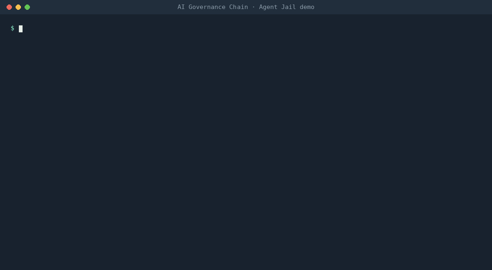

# AI Governance Chain

**Open data and tools that turn the world's AI laws into checks your code, your agents and your CI can run.**

Find which rules apply to your system in your browser: **[aigovernancechain.com](https://aigovernancechain.com)**

[](LICENSE) [](LICENSE-DOCS) [](spec/AI_GOVERNANCE-spec.md) [](cards/README.md) [](#status-and-trust)

```
LAW  ->  OBLIGATION  ->  CONTROL  ->  GATE  ->  EVIDENCE  ->  OVERSIGHT
what      what you         what you     what CI    what you      who can stop
applies   must do          built        checks     can prove     the system
```

"Chain" means a chain of accountability, from the law to the person who can press stop. There is no blockchain.



## Try it in 60 seconds

Needs Node 18 or newer. Nothing to install, no account, no API key.

```bash
# Watch rules stop a misbehaving agent (30 seconds)
npx github:mathieugouanou/aigovernancechain jail

# Which AI rules apply to a chatbot agent you run in the EU and California?
npx github:mathieugouanou/aigovernancechain scope -j EU,US-CA -r deployer -u chatbot,agent

# Write an AI_GOVERNANCE.md for your repo, then check it
npx github:mathieugouanou/aigovernancechain init
npx github:mathieugouanou/aigovernancechain check
```

## What is in v0.1

| Piece | What it does | Start here |
|---|---|---|
| **Obligation Atlas** | 198 cited obligations from 17 regime files covering the 12 Tier-1 regimes: EU, US federal, US states (CA, CO, TX, NY, NYC, IL), China, South Korea, Japan, Vietnam, India, UK, Singapore, Switzerland, Council of Europe | [atlas/](atlas/) · [FORMAT.md](atlas/FORMAT.md) |
| **Regime cards** | One page per regime: who it hits, dates, every obligation with its source | [cards/](cards/README.md) |
| **Deadline calendar** | 300 dated events. Subscribe once, get updates when dates move | [DEADLINES.md](calendar/DEADLINES.md) · `https://aigovernancechain.com/deadlines.ics` |
| **AI_GOVERNANCE.md standard** | One file that tells people, agents and CI how an AI system is governed. Draft spec, JSON schema, generator | [spec/](spec/AI_GOVERNANCE-spec.md) |
| **`aigovchain` CLI** | `scope`, `deadlines`, `init`, `check`, `badge`, `evidence`, `atlas`, `ctf`, `jail`, `bench`, `mcp` | `npx github:mathieugouanou/aigovernancechain help` |
| **Shield GitHub Action** | 16 checks on every PR, job summary, SARIF in code scanning, Evidence Pack artifact | [action/](action/README.md) |
| **MCP server** | Lets any MCP-capable agent query the Atlas and check files | [below](#mcp-server) |
| **Agent Skills** | `ai-law-check`, `ai-governance-md`, `agent-oversight` in the open Agent Skills format | [skills/](skills/README.md) |
| **Agent rails** | Zero-dependency runtime guard for agents in JavaScript and Python: default deny, limits, human approval, spend limit, kill switch, prompt-injection boundaries, decision log | [rails/](rails/rails.mjs) · [sdk/python](sdk/python/README.md) |
| **Fact-based badges** | `AI_GOVERNANCE.md 16/16 checks`. States checked facts, never "certified" | [spec section 6](spec/AI_GOVERNANCE-spec.md#6-badges) |
| **Evidence Pack** | Dated, hashed bundle of what was declared and checked, ready to attest | `aigovchain evidence` |
| **Crosswalks** | 32 controls mapped to the EU AI Act, NIST AI RMF, ISO/IEC 42001 Annex A and the OWASP Agentic Top 10 | [crosswalks/](crosswalks/README.md) |
| **GovBench** | 549 questions testing whether AI models know when AI rules apply and where they are written | [govbench/](govbench/README.md) |
| **AI Governance CTF** | Break a toy agent, fix it with `AI_GOVERNANCE.md`. Levels 01 to 03 live | [ctf/](ctf/README.md) |
| **Public-sector edition** | Obligations for public bodies, procurement clauses, transparency record template | [editions/public-sector/](editions/public-sector/README.md) |
| **Translations** | Quickstart in French, German, Italian, Spanish and Brazilian Portuguese | [i18n/](i18n/README.md) |

## Who it is for

- **Developers:** know which rules hit your feature before you ship it, and keep the answer in the repo.
- **Agent builders:** put hard limits outside the model. A prompt is not a control.
- **Compliance, risk and legal teams:** one cited dataset, one file per system, evidence generated by CI.
- **Public bodies:** procurement clauses and transparency records built on the same data.
- **Researchers and model builders:** GovBench and an open, versioned dataset of AI obligations.

## Add it to your repo

**GitHub Action** (`.github/workflows/ai-governance.yml`):

```yaml
name: AI governance
on: [pull_request, push]
permissions: { contents: read }
jobs:
  shield:
    runs-on: ubuntu-latest
    steps:
      - uses: actions/checkout@v7
      - uses: mathieugouanou/aigovernancechain/action@v0.1.0
```

**Badge** (after `aigovchain badge` writes `.governance/badge.json` and you commit it):

```markdown
[](AI_GOVERNANCE.md)
```

### MCP server

```json
{
  "mcpServers": {
    "aigovernancechain": { "command": "npx", "args": ["-y", "github:mathieugouanou/aigovernancechain", "mcp"] }
  }
}
```

Tools: `scope_check`, `upcoming_deadlines`, `atlas_search`, `atlas_get_obligation`, `atlas_get_regime`, `atlas_list_regimes`, `check_ai_governance_md`, `generate_ai_governance_md`. All read-only.

### Agent rails

```js
import { createRails } from 'aigovernancechain/rails';   // npm install github:mathieugouanou/aigovernancechain
const rails = createRails({ file: 'AI_GOVERNANCE.md', approver: askHuman });
const refund = rails.guard('issue_refund', issueRefund, { amount: a => a.amount });
```

```python
from aigovchain_rails import Rails   # pip install "git+https://github.com/mathieugouanou/aigovernancechain#subdirectory=sdk/python"
rails = Rails.from_file("AI_GOVERNANCE.md", approver=ask_human)
```

## Status and trust

- **Alpha.** Every regime file is marked `draft-unreviewed` until a named expert reviewer signs it off. Each Tier-1 regime has an [open reviewer seat](REVIEWERS.md).
- **Dated and cited.** Every obligation has an "as of" date, a primary source link and a confidence level (`high`, `medium`, `low`). Dates move; the [changelog](CHANGELOG.md) records each change.
- **Not legal advice.** The data helps you find and track obligations. It does not tell you whether you comply. See [DISCLAIMER.md](DISCLAIMER.md).
- **Honest outputs.** Tools state facts ("14/16 checks passed"). Nothing here certifies anyone.
- **AI-assisted.** Much of v0.1 was drafted with AI assistance and checked against primary sources by a human. Details in this repo's own [AI_GOVERNANCE.md](AI_GOVERNANCE.md).

## Roadmap

| Release | Date | Focus |
|---|---|---|
| v0.1 | 4 Nov 2026 | Everything above |
| v1 | 30 Nov 2026 | Neutral charter in force, GitHub organisation, foundation application, policy packs (OPA/Cedar), AI-BOM generator, attestation recipe (Sigstore), CTF levels 04 to 10, first Tier-2 regimes, weekly Law Diff releases |
| v2 | 18 Jan 2027 | Signed badges backed by attestations, OpenTelemetry governance events, red-team runner, Annex IV and NIST exporters, CTF levels 11 to 20, 15 languages |

All 37 planned ideas and their dates: [ROADMAP.md](ROADMAP.md).

## Help wanted

- **Talk to us (20 minutes).** We are running 40 discovery interviews by 31 Dec 2026, including 10 with agent builders. [Volunteer here](https://github.com/mathieugouanou/aigovernancechain/issues/new?template=discovery-interview.yml). Guide: [DISCOVERY.md](DISCOVERY.md).
- **Review a regime.** Lawyers, regulators and practitioners: [REVIEWERS.md](REVIEWERS.md).
- **Fix a fact.** Wrong date, broken link, missing duty: [open a correction](https://github.com/mathieugouanou/aigovernancechain/issues/new?template=obligation-correction.yml).
- **Add a regime.** Follow [atlas/FORMAT.md](atlas/FORMAT.md) and [CONTRIBUTING.md](CONTRIBUTING.md).

## Governance and neutrality

The project runs under a [neutral technical charter](CHARTER.md) and is preparing an application to a neutral open-source foundation by 30 Nov 2026. No paid features live in this repository.

**Disclosure.** The founder, Mathieu K. Gouanou, also offers commercial AI-governance products and services, including the instrument library that used to live in this repository. That library moved to [mathieugouanou/aigovernancechain-library](https://github.com/mathieugouanou/aigovernancechain-library) under its original licence. This repository stays vendor-neutral; see [CHARTER.md](CHARTER.md) for conflict-of-interest rules.

## Licence

Code: [Apache-2.0](LICENSE). Data, documentation and the AI_GOVERNANCE.md specification: [CC BY 4.0](LICENSE-DOCS). See [NOTICE](NOTICE) and [TRADEMARK.md](TRADEMARK.md). Cite with [CITATION.cff](CITATION.cff).

If this saved you time, a star helps other teams find it.
